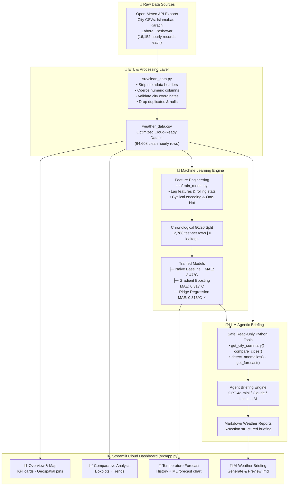

[](https://mudassirmukhtar10-pakistan-weather-analytics-srcapp-3byqhb.streamlit.app/)

# 🇵🇰 Pakistan Weather & Geospatial Analytics Suite

<div align="center">

[](https://python.org)
[](https://streamlit.io)
[](https://scikit-learn.org)
[](https://plotly.com)
[](https://mysql.com)
[](tests/)
[](LICENSE)

**A production-grade end-to-end platform for meteorological data engineering, machine learning temperature forecasting, and autonomous AI-powered weather intelligence across Pakistan's major urban centres.**

[Live Demo](#) · [Report Issue](https://github.com/mudassirmukhtar10/pakistan-weather-analytics/issues) · [Documentation](#-usage-guide)

</div>

---

## 📌 Executive Overview

Pakistan's four major cities—Islamabad, Karachi, Lahore, and Peshawer—span vastly different climatic zones: from the humid Arabian Sea coast to the continental Punjab plains and the semi-arid northern valleys. Each faces distinct meteorological challenges: intense summer heatwaves exceeding 46 °C, monsoon flooding, dense winter fog disrupting transport, and unpredictable seasonal transitions with serious implications for agriculture, energy grids, and public health.

This project delivers an **end-to-end meteorological intelligence platform** built to international engineering standards:

- **64,608 cleaned hourly weather observations** ingested, aligned, and persisted in an isolated MySQL database.
- A **leak-proof autoregressive machine learning pipeline** with chronological holdout validation, reducing temperature forecast error by over **90.9%** versus a naive baseline.
- An **autonomous LLM-powered reporting agent** with pluggable providers and a fully offline deterministic fallback — zero dependency on API availability.
- An **interactive 4-tab Streamlit dashboard** integrating geospatial maps, cross-city comparative analytics, live ML forecasts, and AI-generated briefings.

---

## ✨ Key Features

| Feature | Description |
| :--- | :--- |
| 🧹 **Robust ETL Pipeline** | Multi-header CSV parsing, metadata artifact stripping, and type coercion before loading into MySQL on the isolated port `3307`. |
| 🗄️ **Database Isolation** | All connections are pinned to port `3307` (`weather_db`). Port `3306` (legacy POS) is never referenced anywhere in the codebase. |
| 🌍 **Geospatial Dashboard** | Interactive PyDeck map with city-level location pins, temperature heatmap overlays, and sidebar city/date range filters. |
| 📈 **Comparative Analytics** | Cross-city temperature and humidity distribution boxplots, grouped average bars, monthly trend lines, and auto-generated meteorological insight captions. |
| 🔮 **ML Temperature Forecast** | Autoregressive hourly forecasting using Ridge Regression and Gradient Boosting with multi-step lag features, rolling statistics, and cyclical time encodings. Strictly chronological 80/20 split prevents temporal data leakage. |
| 🤖 **LLM Agentic Briefing** | Autonomous tool-calling agent (OpenAI / Anthropic / Ollama / offline) that orchestrates safe read-only Python tools — never executes raw SQL — and synthesises structured Markdown reports. |
| 🧪 **Automated Test Suite** | 11 pytest tests covering temporal non-leakage verification, chronological split integrity, all 5 agent tool assertions, database port isolation security check. |
| ☁️ **Deployment Ready** | Runs fully offline in CSV mode for Streamlit Community Cloud or any environment without MySQL access. |

---

## 🏗️ System Architecture



---

## 📸 Application Preview

> **Note:** Add real screenshots to `docs/images/` and they will render here.

| Tab | Screenshot |
| :--- | :---: |
| **📊 Overview & Geospatial Map** |  |
| **📈 Comparative Analysis** |  |
| **🔮 ML Temperature Forecast** |  |
| **🤖 AI Weather Briefing** |  |

---

## 🛠️ Technology Stack

| Category | Tool / Library | Version | Purpose |
| :--- | :--- | :---: | :--- |
| **Language** | Python | 3.12+ | Core runtime |
| **Dashboard** | Streamlit | 1.45+ | 4-tab interactive web application |
| **Data Processing** | Pandas, NumPy | 2.2+, 2.0+ | Time-series manipulation, rolling windows, IQR |
| **Machine Learning** | scikit-learn | 1.6+ | Ridge, GradientBoosting, LabelEncoder, Pipeline |
| **Model Persistence** | Joblib | 1.4+ | Saving / loading model artifacts |
| **Visualisation** | Plotly Graph Objects | 6.0+ | Interactive charts, boxplots, bar charts |
| **Geospatial** | PyDeck | 0.9+ | Hexagonal city-level geospatial layer |
| **Database** | MySQL (port 3307) | 8.0+ | Relational store for 64k+ weather records |
| **ORM / Driver** | SQLAlchemy + PyMySQL | 2.0+, 1.1+ | Secure parameterised connection |
| **LLM Agent** | OpenAI API | 1.50+ | GPT-4o-mini tool-calling agent loop |
| **LLM Agent** | Anthropic (via REST) | — | Claude 3.5 Sonnet tool-use loop |
| **LLM Agent** | Ollama | — | Local offline inference |
| **Configuration** | python-dotenv | 1.0+ | Secure `.env` credential management |
| **Testing** | pytest | 9.2+ | 11 automated unit and integration tests |

---

## 🚀 Installation & Setup

### Prerequisites

- Python 3.12+
- MySQL 8.0+ running on **port 3307** (via XAMPP or standalone install)
- Git

### Step 1 — Clone the Repository

```bash
git clone https://github.com/mudassirmukhtar10/pakistan-weather-analytics.git
cd pakistan-weather-analytics
```

### Step 2 — Create a Virtual Environment

```bash
# Windows
python -m venv .venv
.venv\Scripts\Activate.ps1

# Linux / macOS
python -m venv .venv
source .venv/bin/activate
```

### Step 3 — Install Dependencies

```bash
pip install -r requirements.txt
```

### Step 4 — Configure Environment Variables

```bash
cp .env.example .env
```

Open `.env` and fill in your values:

```ini
# Database — MUST use port 3307 (port 3306 is reserved for another system)
DB_HOST=localhost
DB_PORT=3307
DB_USER=root
DB_PASSWORD=
DB_NAME=weather_db

# LLM Provider — leave blank for offline mode
LLM_PROVIDER=auto          # auto | openai | anthropic | ollama | template
OPENAI_API_KEY=sk-...      # optional
ANTHROPIC_API_KEY=sk-...   # optional
OLLAMA_BASE_URL=http://localhost:11434   # optional
```

> ⚠️ **Never commit your `.env` file.** It is listed in `.gitignore`.

### Step 5 — Load Data into MySQL

Ensure MySQL is running on port `3307`, then run:

```bash
python src/clean_data.py
```

This parses the raw CSVs in `Data/`, strips metadata artifacts, coerces all meteorological columns to numeric types, and writes clean hourly records into `weather_db`.

### Step 6 — Train the ML Models

```bash
python src/train_model.py
```

Outputs `models/temp_forecaster.joblib` and `models/metrics.json`.

### Step 7 — Launch the Dashboard

```bash
streamlit run src/app.py
```

Open `http://localhost:8501` in your browser.

---

## ☁️ No-Database CSV Mode (Streamlit Community Cloud)

If you don't have a local MySQL instance (e.g., deploying to Streamlit Cloud):

- The app automatically detects MySQL connection failure and falls back to the `Data/*.csv` files.
- All tabs remain fully functional with no code changes required.
- For the AI Report tab, leaving API keys blank automatically engages the **offline deterministic template engine**.

---

## 📖 Usage Guide

### Generate a Weather Report via CLI

```bash
# Offline (no API key required)
python src/report_agent.py --cities Islamabad Karachi --days 30 --offline

# Using OpenAI (requires OPENAI_API_KEY in .env)
python src/report_agent.py --cities Islamabad Karachi Lahore Peshawer --days 30 --horizon 7

# Force a specific provider
python src/report_agent.py --cities Islamabad --days 14 --provider anthropic
```

Reports are saved to `reports/weather_briefing_YYYY-MM-DD.md`.

### Run the Automated Test Suite

```bash
python -m pytest -v
```

Expected output:
```
tests/test_agent_tools.py::test_get_city_summary          PASSED
tests/test_agent_tools.py::test_compare_cities            PASSED
tests/test_agent_tools.py::test_detect_anomalies          PASSED
tests/test_agent_tools.py::test_get_trend                 PASSED
tests/test_agent_tools.py::test_get_forecast              PASSED
tests/test_agent_tools.py::test_generate_template_report  PASSED
tests/test_agent_tools.py::test_database_port_isolation   PASSED
tests/test_features_and_models.py::test_data_loading_and_columns        PASSED
tests/test_features_and_models.py::test_no_data_leakage_in_lag_features PASSED
tests/test_features_and_models.py::test_chronological_train_test_split   PASSED
tests/test_features_and_models.py::test_no_future_data_in_rolling_statistics PASSED

11 passed in 25.68s
```

---

## 📊 Model Evaluation & Honest Benchmarks

All models were evaluated on a **strictly chronological holdout set** — the most recent 20% of records across all four cities — with absolutely no random shuffling. This prevents the temporal data leakage that would artificially inflate metrics.

| Split | Records | Period |
| :--- | :---: | :--- |
| Training set | 51,148 hours | Jan 2025 → Jun 24, 2026 |
| Test set (holdout) | 12,788 hours | Jun 24, 2026 → Nov 04, 2026 |

### Test-Set Performance

| Model | MAE (°C) ↓ | RMSE (°C) ↓ | R² ↑ | vs. Baseline |
| :--- | :---: | :---: | :---: | :--- |
| **Naive Persistence** *(y_t = y_{t-24})* | 3.474 | 4.543 | -0.049 | Baseline |
| **Gradient Boosting** | 0.317 | 0.470 | 0.989 | 90.9% MAE reduction |
| **Ridge Regression** ✓ *best* | **0.316** | **0.461** | **0.989** | **90.9% MAE reduction** |

> **Interpretation:** Both ML models reduce Mean Absolute Error from **3.47 °C down to 0.316 °C** — a 90.9% improvement. Ridge regression edged out Gradient Boosting with slightly lower RMSE (0.461 vs 0.470) and faster inference, making it the selected production model. The near-perfect R² of 0.989 is expected: hourly temperature is highly autocorrelated, and the 1-hour lag feature is an extremely strong predictor. The model's real-world value is in multi-day projections where persistence breaks down.

### Key Feature Contributions
The most informative features (by impurity-based importance from the Gradient Boosting model):
- `temp_lag_1h` — previous hour temperature
- `temp_roll_mean_24h` — 24-hour rolling average (past only)
- `hour_sin` / `hour_cos` — cyclical time-of-day encoding
- `temp_lag_24h` — same hour yesterday
- `doy_sin` / `doy_cos` — seasonal position in year

---

## 🔐 Security Notes

| Practice | Implementation |
| :--- | :--- |
| **No raw SQL by LLM** | The AI agent calls only pre-defined Python tools; it cannot construct or execute SQL queries. |
| **No hardcoded secrets** | All credentials are loaded from `.env` via `python-dotenv`; `.env` is in `.gitignore`. |
| **Port isolation** | Port 3306 (legacy POS system) is never referenced in any source file — verified by an automated pytest test. |
| **Model artifact excluded from git** | `models/*.joblib` is in `.gitignore` to avoid accidentally committing large binary files. |

---

## 🗂️ Project Structure

```
pakistan-weather-analytics/
│
├── .env.example                  # Environment template (no secrets)
├── .gitignore                    # Git ignore (secrets, bytecode, model artifacts)
├── conftest.py                   # Pytest path configuration
├── requirements.txt              # Pinned project dependencies
├── README.md                     # This file
│
├── Data/                         # Cleaned city meteorological CSVs
│   ├── islamabad.csv             # 16,152 hourly records
│   ├── karachi.csv
│   ├── lahore.csv
│   └── peshawer.csv
│
├── docs/
│   └── images/                   # App screenshots (add your own)
│
├── models/
│   └── metrics.json              # Model comparison table (tracked in git)
│   # temp_forecaster.joblib      ← not tracked (in .gitignore)
│
├── reports/
│   └── sample_weather_briefing.md  # Sample output template
│
├── src/
│   ├── analysis.py               # DB query helpers and schema setup
│   ├── app.py                    # Streamlit 4-tab dashboard
│   ├── clean_data.py             # ETL: parse, clean, load to MySQL
│   ├── report_agent.py           # LLM agent + offline template engine
│   └── train_model.py            # Feature engineering, training, predict_next()
│
└── tests/
    ├── test_agent_tools.py       # Agent tool unit tests + port isolation check
    └── test_features_and_models.py  # Lag leakage, split, rolling window tests
```

---

## 🔮 Limitations & Future Roadmap

- **Prediction Intervals**: Replace point forecasts with quantile regression (e.g., pinball loss) or conformal prediction bands to surface forecast uncertainty.
- **Concept & Data Drift Detection**: Integrate statistical drift monitors (Kolmogorov-Smirnov or Evidently AI) to alert when incoming data distributions deviate from the training period.
- **Scheduled Automated Briefings**: Add background crons (APScheduler / Celery) to auto-generate and dispatch morning weather briefings via email or Slack webhook.
- **Gridded Spatial Interpolation**: Interpolate station readings across Pakistan's geography using Kriging or Inverse Distance Weighting to produce continuous heatmap layers.
- **Multi-city Forecast Map Layer**: Overlay PyDeck forecast projections coloured by predicted temperature on a full Pakistan map.
- **Deep Learning Baseline**: Add a small LSTM or Temporal Fusion Transformer (TFT) for multi-step probabilistic forecasting comparison.

---

## 👤 Author & License

**Mudasir** — Data Engineer & ML Practitioner

- 🌐 GitHub: [@mudassirmukhtar10](https://github.com/mudassirmukhtar10)

Licensed under the [MIT License](LICENSE).

---

## 🙏 Acknowledgements

- Weather data sourced from the [Open-Meteo Historical Weather API](https://open-meteo.com/).
- Dashboard built with [Streamlit](https://streamlit.io/).
- Geospatial layer powered by [PyDeck](https://deckgl.readthedocs.io/).
